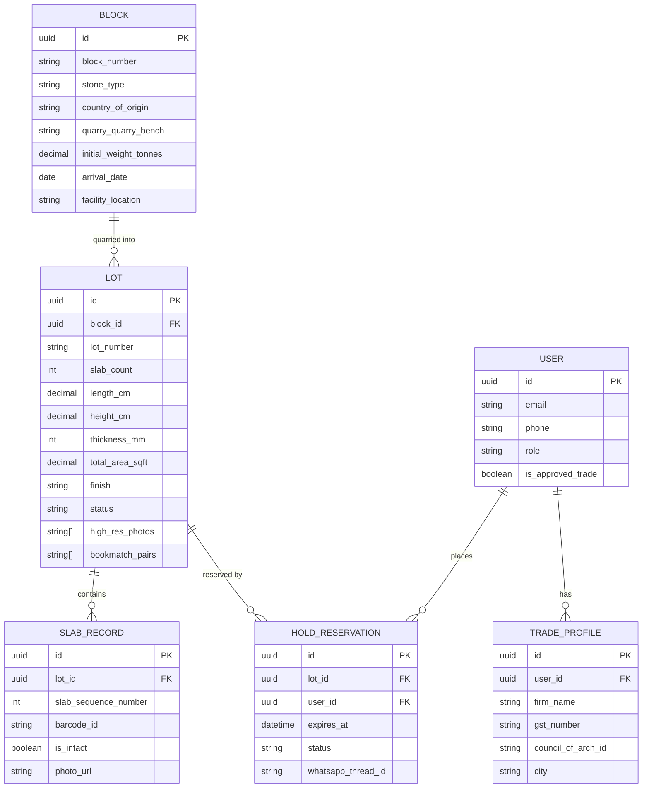

# INTIOSS Luxury Surfaces — Inventory Management & Trade Portal Architecture Proposal

*Phase 5 Proposal Document — Prepared for INTIOSS Executive Review*  
*Date: October 2026*

---

## 1. Executive Summary & Current State Analysis

### Current State (Draft 4)
- **Zero Authentication / Role System:** There is currently no user login, no role-based access control, and no private trade area.
- **Static Catalog Data:** Product specifications and stone metadata reside in version-controlled TypeScript definition files (`data/products.ts`). Adding new inventory requires developer code intervention.
- **Unconnected Hold Workflow:** The "Hold This Slab" interface collects customer requirements and opens a pre-formatted WhatsApp consultation link. It does not verify live stock levels, reserve actual physical slabs, or trigger automated warehouse holds.
- **No Stockyard / Lot Tracking:** Slabs are presented as collection archetypes rather than distinct quarry block lots with individual bundle numbers, physical dimensions, or lot-specific vein photography.

---

## 2. Proposed System Scope

The proposed next phase will introduce a production-grade, real-time inventory management engine and an exclusive Trade Concierge Portal for verified architects, interior designers, and estate builders.

### Core Modules
1. **Physical Block, Lot & Slab Registry:**
   - Tracking from quarry extraction / import container arrival to factory processing in Silvassa and showroom presentation.
   - Individual lot records containing: Quarry Block ID, Lot/Bundle Number, Slab Count, Exact Metric Dimensions (Length × Height × Thickness), Total Usable Area (Sq.Ft. and Sq.M.), Surface Finish, and Lot-Specific 4K High-Resolution Photography (full bundle face + vein macros).
2. **INTIOSS Team Admin Operations Suite:**
   - Secure web portal enabling inventory managers to add newly processed lots, toggle status (`Available`, `Reserved - 48h Hold`, `Sold`, `In Transit`), update pricing tiers, and drag-and-drop batch photography without writing code.
3. **Trade Portal & Architect VIP Access:**
   - Passwordless / magic-link authentication for approved architectural firms.
   - Real-time stockyard availability with live square footage counters.
   - High-resolution uncompressed slab downloads for 3D architectural rendering (SketchUp / 3ds Max / Revit / Blender).
   - Private client presentation mode (removes wholesale price indications).
4. **Automated Live "Hold This Slab" Engine:**
   - Directly locks specific lot inventory for a configurable window (e.g., 48 business hours).
   - Generates an official INTIOSS Hold Slip PDF sent instantly via automated WhatsApp Business API and email to the architect and INTIOSS sales directors.
   - Prevents duplicate reservations across studios while giving priority to verified trade partners.

---

## 3. Recommended Architecture Options

### Option A: Modern Headless Cloud Architecture (Recommended)
- **Database & Auth:** Supabase (PostgreSQL with Row Level Security, Realtime subscriptions, and S3-compatible asset storage).
- **Backend / API:** Next.js Server Actions & API Routes with Zod schema validation.
- **Image Pipeline:** Cloudinary or AWS S3 + CloudFront with on-the-fly thumbnail generation and watermark protection.
- **Notifications:** Twilio WhatsApp Business API + Resend for transactional email dispatch.
- **Pros:** Seamless integration with existing Next.js App Router codebase; rapid delivery; ultra-low server maintenance; rock-solid role-based security.

### Option B: Dedicated Headless ERP / PIM Integration
- **Platform:** MedusaJS or Strapi Enterprise connected to existing legacy warehouse software (e.g., SAP / Tally).
- **Pros:** Robust if INTIOSS already operates a complex multi-warehouse ERP system for Gandhi Civil Décor and Quality Marble.
- **Cons:** Significantly higher initial configuration overhead and longer delivery timeline.

---

## 4. Proposed Database Schema & Data Model



---

## 5. Implementation Roadmap & Timeline

| Phase | Milestone | Estimated Duration |
| :--- | :--- | :--- |
| **Phase 5.1** | Database schema deployment, authentication setup & trade registration flow | 2 Weeks |
| **Phase 5.2** | INTIOSS internal admin dashboard (lot creation, photo manager, stock status) | 2–3 Weeks |
| **Phase 5.3** | Architect trade portal (VIP catalog view, CAD asset downloads, presentation mode) | 2 Weeks |
| **Phase 5.4** | Automated real-time hold engine, PDF generation & WhatsApp webhook integration | 1–2 Weeks |
| **Phase 5.5** | End-to-end QA, staff training at Silvassa & Mumbai offices, production launch | 1 Week |

---

## 6. Commercial Quote & Investment Placeholder

```
[COMMERCIAL QUOTE PLACEHOLDER — To be finalized based on selected architecture option (Option A vs. Option B) and custom ERP integration scope.]
```
